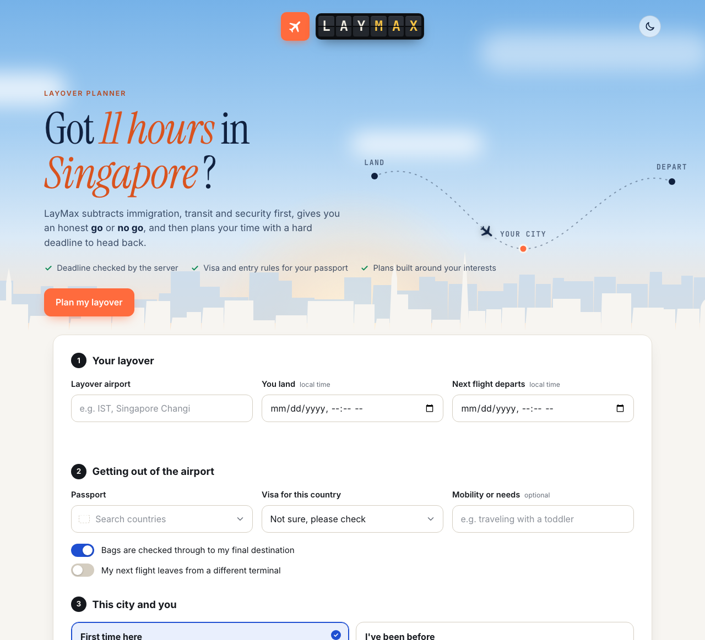
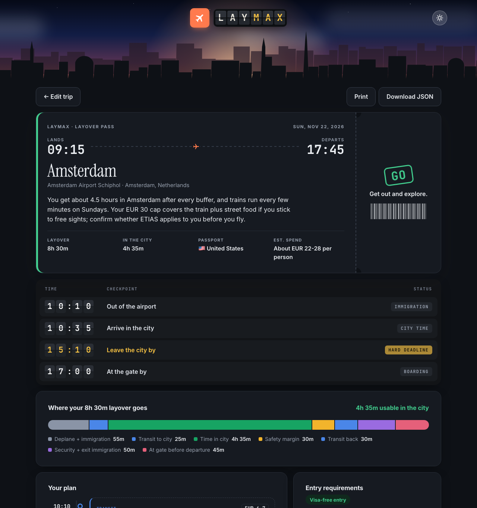
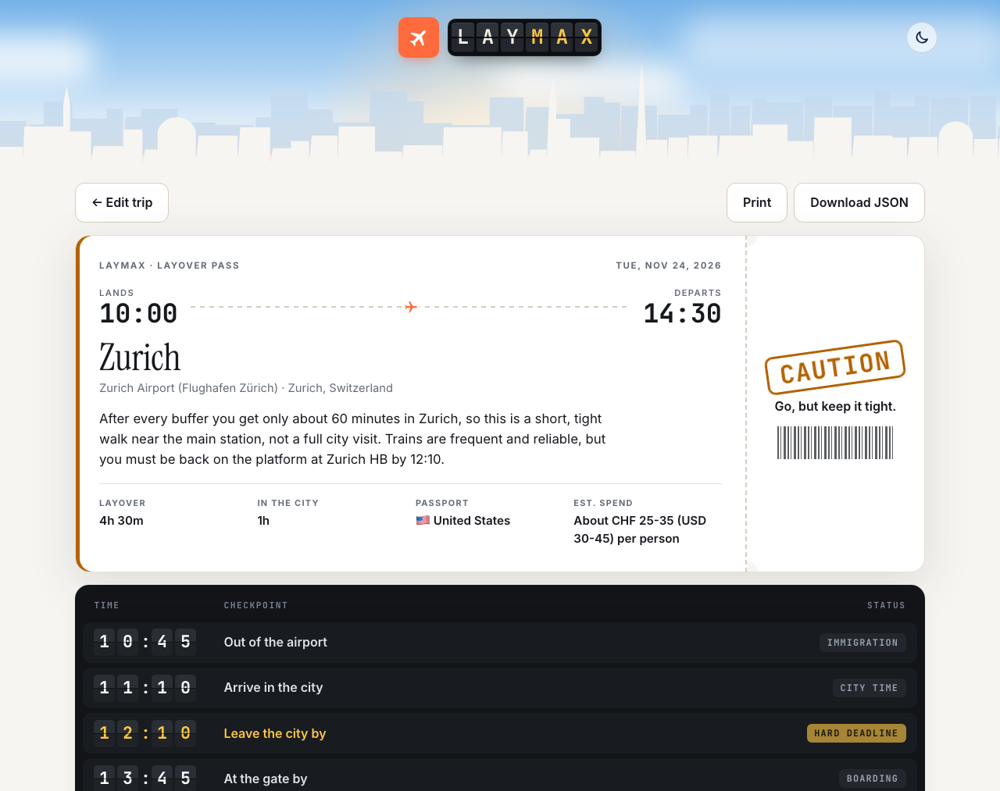
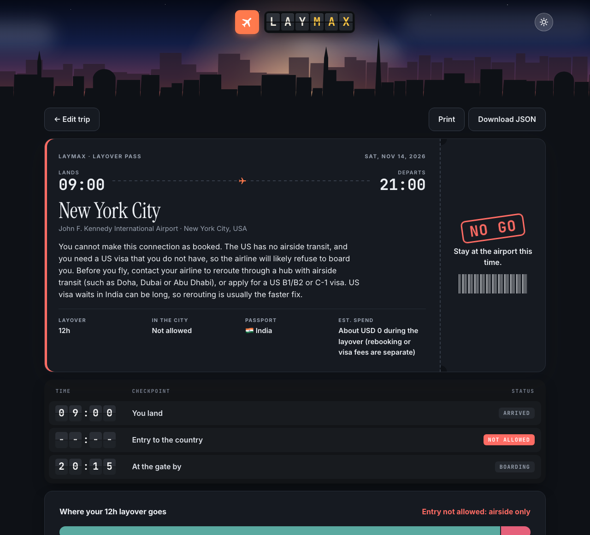
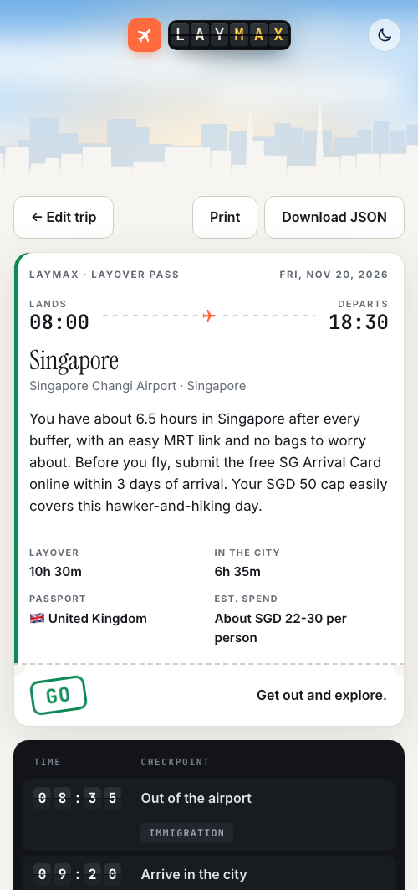

# ✈ LayMax: Layover Maximizer

**CS4680 Prompt Engineering · AI Assistant Project**

Long layovers are either hours wasted at the gate or a gamble that you'll make it back in time. Most travelers don't know how much of a 9-hour layover is really theirs once immigration, transit, and security are subtracted.

LayMax **does the math first**, gives an honest **GO / CAUTION / NO GO** verdict, and only then builds a minute-by-minute plan with a **hard deadline** to head back to the airport.

## Screenshots

**Input screen** (light mode): the traveler's layover, passport and visa, whether they've been to the city before, interests, budget, pace, and safety margin.



| GO: Amsterdam on a EUR 30 cap (dark mode) | CAUTION: a tight hour in Zurich (light mode) |
|---|---|
|  |  |

| NO GO: no visa to connect through JFK | Mobile: returning visitor in Singapore |
|---|---|
|  |  |

Every result screen shows a boarding pass with the verdict stamp, a departures board with the key times and the hard deadline, a bar showing where every minute of the layover goes, and a timed itinerary.

## How it works

```
 Browser (input screen)  ──POST /api/plan──►  Flask server (app.py)
                                               │
                                               ├─ validate input                       planner.validate_input
                                               ├─ STAGE 1 · Claude: time check         minutes + entry rules only (TimeCheck)
                                               ├─ server: the math                     clock times + minimum verdict
                                               ├─ STAGE 2 · Claude: plan               itinerary inside the fixed times (LayoverPlan)
                                               ├─ server: check plan vs. deadline      planner.find_problems
                                               │     └─ problems? → draft + exact faults back to stage 2 (refinement)
                                               ▼
 Browser (output screen) ◄──── JSON plan ──────┘
```

The model never does clock arithmetic. Early versions asked one Claude call to estimate the times, calculate the deadline, and plan, all at once. Testing showed it sometimes slipped when subtracting across hours (deadlines off by 20 to 60 minutes). The server always caught it, but every catch cost an extra round trip. Splitting the work into a two-call chain, with the server doing the math in between, took the first-try pass rate from 5 of 8 to 9 of 9 test runs.

| Part | File |
|---|---|
| Prompts (plain text): shared persona, stage 1, stage 2 | `LayoverMaximizer-Prompt.txt` |
| Claude calls, JSON schemas, math + validation | `planner.py` |
| Web server | `app.py` (or `main.py` in PyCharm) |
| Web UI | `templates/index.html`, `static/style.css`, `static/app.js` |
| Prompt test harness | `test_prompt.py` |

**Model:** `claude-opus-5-5` through the official `anthropic` Python SDK, with structured outputs (`messages.parse` and Pydantic schemas).

## Prompt engineering techniques

1. **Persona pattern.** Claude is "LayMax, a veteran travel planner and former airport operations manager" who "never gambles with a traveler's connecting flight." The persona gives it airport-specific expertise (immigration queues, train lines) and a conservative attitude toward risk.
2. **Prompt chaining ("math first").** Two prompts run in sequence. Stage 1 only estimates minutes and entry rules; the server converts them into exact clock times and a minimum verdict; stage 2 plans inside those fixed times and may only make the verdict stricter. Each prompt has one focused job, and the step the model was weakest at (clock arithmetic) is handed to code.
3. **Few-shot examples.** Each stage has a complete worked example (the same Doha layover), showing the expected estimates, tone, level of detail, and how the final stop is the ride back that starts at the deadline.
4. **Output template / structured JSON.** Pydantic schemas (`TimeCheck`, `LayoverPlan`) are enforced through Claude's structured outputs. The backend can rely on every field being present and correctly typed, so it can do math on it.
5. **Iterative refinement (automated).** The server checks every stop against the deadline. If a stop runs late, overlaps another, or the plan is looser than the minimum verdict, the draft and the exact list of problems go back to stage 2 for a corrected version. The UI shows whether a revision happened ("How we calculated this").
6. **Iterative prompt development.** `test_prompt.py` runs 8 scenarios against the real API. Its failures drove the prompt changes: an airside-only rule for travelers without a visa, short price labels, and finally the move to a two-call chain.
7. **Context control / guardrails.** Rules cover opening hours, first-timer vs. returning-visitor recommendations, luggage storage when bags aren't checked through, and "when in doubt, choose the more conservative verdict."

### Why JSON output?
The server needs to **compute on** the answer (add up minutes, compare timestamps, override an unsafe verdict) and the UI needs to render separate pieces (verdict badge, deadline board, time-budget bar, timeline). Free text can't be checked or rendered reliably; JSON can.

## Setup

```bash
python3 -m venv .venv
source .venv/bin/activate          # Windows: .venv\Scripts\activate
pip install -r requirements.txt
cp .env.example .env               # then paste your ANTHROPIC_API_KEY
python app.py
```

Open **http://127.0.0.1:5050**. (Port 5000 is taken by AirPlay Receiver on macOS.)

**Demo mode (no API key, no cost):** `LAYMAX_MOCK=1 python app.py`. A bar above the form replays real Claude results saved in `demo_samples/` (Singapore, Zurich CAUTION, Tokyo overnight, Amsterdam and Singapore with budget caps, London and Istanbul NO GO, JFK visa NO GO) plus the Doha example. `?autoplay=<sample name>` (for example `?autoplay=jfk-visa-nogo`) jumps straight to one. Set `LAYMAX_MOCK_DELAY` (seconds, default 2) to control the fake loading time. This is a good backup for the live demo.

## Testing the prompt

```bash
python test_prompt.py        # 8 scenarios: GO, CAUTION, short layover, visa NO_GO, borderline, overnight, budget caps, returning visitor
python test_prompt.py 3      # just one
```

Results are saved to `test_results/scenario_N.json`.

## Future ideas
- Live flight lookup by flight number (arrival and departure times plus terminals)
- Live transit status and weather
- Push notification "time to head back" countdown
- Shareable trip link and calendar export
